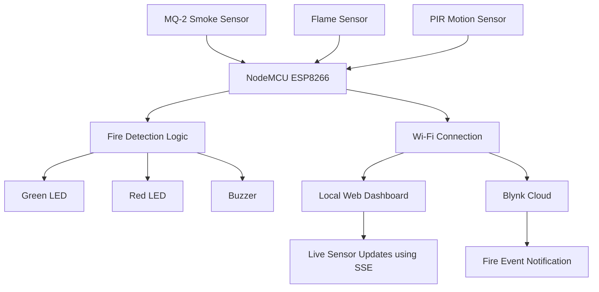

# System Architecture

## 1. Overview

The Smart Fire Escape System follows an IoT-based architecture in which sensors collect environmental information, the NodeMCU ESP8266 processes the readings, and alerts are provided through local output devices and connected software services.

## 2. Architecture Diagram

## 3. Main Components

- **Input Layer:** MQ-2, flame and PIR sensors collect environmental readings.
- **Processing Layer:** NodeMCU ESP8266 processes sensor readings and determines the fire detection state.
- **Alert Layer:** LEDs and buzzer provide local visual and audio alerts.
- **Web Monitoring Layer:** ESP8266 hosts a web dashboard that displays sensor information and receives live updates through Server-Sent Events (SSE).
- **Cloud Notification Layer:** Blynk provides remote event notifications when connectivity is available.

## 4. System Workflow

1. Sensors continuously provide readings to the ESP8266.
2. The controller checks smoke and flame conditions.
3. If smoke or flame is detected, the fire alert state is activated.
4. The red LED and buzzer turn on, while the green LED turns off.
5. The dashboard receives sensor updates through the local Wi-Fi connection.
6. The system sends a Blynk event notification when the cloud connection is available.
7. When no fire condition is detected, the system returns to its safe indicator state.

## 5. Communication

| Communication | Purpose |
|---|---|
| Sensor to ESP8266 | Sensor readings |
| ESP8266 to dashboard | HTTP and SSE |
| ESP8266 to Blynk | Cloud event notification |

## 6. Note

The emergency exit guidance displayed by this prototype uses predefined demonstration logic. It does not perform dynamic route calculation or verify actual evacuation conditions.
